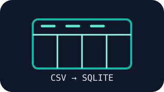

<div align="center">


[](LICENSE)
[](https://github.com/CyberLoop-dev/csv-sqlite-loader)
[](https://github.com/CyberLoop-dev/csv-sqlite-loader/stargazers)
[](https://github.com/CyberLoop-dev/csv-sqlite-loader/commits/main)

</div>

## 🧭 Overview
A dependency-free Python CLI that imports a CSV file into a local SQLite database. It infers INTEGER, REAL, or TEXT column types, converts empty cells to NULL, and quotes identifiers safely.

## ✨ Features
- 📥 Loads CSV headers and rows into a SQLite table.
- 🧮 Infers a practical SQLite affinity for each column.
- 🔒 Uses parameterized inserts and quoted identifiers.
- 🧪 Supports safe table replacement with an explicit flag and includes tests.

## 🖥️ Demo
No hosted demo is published. Import a local CSV using the command below.

## 🚀 Quick Start
```bash
python main.py sample.csv data.db --table records
```
Use `--replace` to replace an existing table. Run tests with `python -m unittest discover -s tests -v`.

## 🧰 Tech Stack
Python 3.10+ standard library: csv, sqlite3, argparse, and unittest. No third-party dependencies.

## 🗂️ Folder Structure
```text
csv-sqlite-loader/
├── main.py
├── tests/
├── assets/
├── .github/workflows/
└── pyproject.toml
```

## 🛣️ Roadmap
- [x] CSV import with type inference.
- [x] Empty-cell NULL conversion and safe identifiers.
- [ ] Add configurable type overrides and batch-size controls.

## 🤝 Contributing
Contributions are welcome. Preserve safe SQL handling and add fixtures for new CSV edge cases.

## 📄 License
MIT — see [LICENSE](LICENSE).

<div align="center">

</div>
